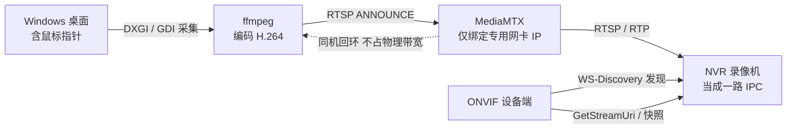

# 🖥️➡️📼 ScreenCastNVR · 屏幕推流 · 录像机接入

> 把 Windows 桌面（含鼠标指针）实时编码成 H.264，用 **ONVIF + RTSP** 两种标准方式，
> 让录像机（NVR）把它当成一台「网络摄像机」——一键添加、预览、录像、回放。
> 数据流走**独立网卡 + 独立 IP**，不经过主机上网网卡。

[](https://www.microsoft.com)
[](./LICENSE)
[](./CHANGELOG.md)
[]()

---

## ✨ 这是什么

ScreenCastNVR 让一台普通的 Windows 电脑「变成」一路可被录像机接入的视频源。
它持续捕获屏幕画面，实时编码为 H.264，并通过标准的 **ONVIF / RTSP** 协议对外提供视频流——
于是海康、大华、宇视等主流 NVR 可以直接把它当作一台 IP 摄像机来管理：

- 在 NVR 里「一键添加」自动发现；
- 频道列表里看到实时缩略图；
- 像监控摄像头一样预览、定时/移动侦测录像、回放。

典型用途：**电脑操作远程巡检 / 工控机桌面留痕 / 教学演示归档 / 数字看板统一上墙**。

---

## 🚀 核心特性

- **桌面实时采集 → H.264 → RTSP 服务**：内置 ffmpeg + MediaMTX，打包为单目录 EXE，双击即用。
- **ONVIF Profile S 设备端**：WS-Discovery 自动发现 + Device/Media 标准服务 + JPEG 快照，
  NVR 可「一键添加」，频道列表显示缩略图；支持可选 Digest 鉴权。
- **专用网卡绑定（关键特性）**：RTSP 与 WS-Discovery 只监听你指定的那块网卡 IP，
  **推流流量不经过主机上网网卡**，互不干扰、互不争带宽。
- **一键独立 IP**：为所选网卡写入静态 IP（不设网关）并放行防火墙，需 UAC 提权，按 MAC 记忆网卡。
- **编码器自动探测**：NVENC → QSV → AMF → x264 逐个探测，硬件编码优先，省 CPU。
- **DXGI 采集 + 自动回退**：默认用 DXGI Desktop Duplication（GPU 侧合成，不 BitBlt），
  解决「推流时本机鼠标指针闪烁」问题；不支持或多屏副屏时自动回退 GDI。
- **多屏 / 分辨率可控**：可采集全屏、指定显示器，或缩放为 1080p / 720p / 540p / 360p。
- **录像机接入引导**：实时显示 RTSP 地址，内置**海康 / 大华 / 宇视**添加步骤。
- **连通性自检**：从本机 RTSP 反拉一帧，确认录像机将实际看到的画面。
- **运行状态全景**：实时帧率、码率、接入设备数、客户端 IP；异常自动重连（1→5 秒退避）。
- **托盘常驻**：关闭窗口最小化到托盘，支持开机自启与「启动即推流」。

---

## 🧭 工作原理



> 推流以 RTSP ANNOUNCE 发到本机 MediaMTX；在 Windows 下同机访问自身 IP 走内部回环，
> 不占用物理网卡带宽。MediaMTX 的 `rtspAddress` / `rtpAddress` / `rtcpAddress` 全部绑定到专用网卡 IP，
> 管理 API 只监听 `127.0.0.1`。

---

## 🏁 快速开始

### 1. 准备一块「专用网卡」

插上一块有线/无线网卡（USB 网卡即可），用网线直连 NVR 的 PoE/网口，或接到同一台二层交换机。
**不要让这块网卡承担主机上网**（不要设网关）。

### 2. 运行程序

下载 [`ScreenCastNVR_v1.2.zip`](../../releases)，解压后双击 `ScreenCastNVR.exe`。
首次使用：

1. **「网络」标签页** → 在网卡列表里选中你的专用网卡；
2. 点击 **「配置独立 IP」**（会弹 UAC 提权），程序自动写入静态 IP 并放行防火墙；
3. 确认 ONVIF 开关已打开（默认 80 端口，占用时自动降级 8080 / 8081）。

### 3. 开始推流

在 **「画面」标签页** 选择显示器与分辨率/帧率/码率，点击「开始推流」。
界面会显示 `推流中 · N 台设备`，并给出 `rtsp://<专用IP>:8554/screen`。

### 4. 在 NVR 里添加

| 品牌 | 添加方式 |
| --- | --- |
| **海康威视** | 主菜单 → 通道管理 → 自定义添加 → 协议 `ONVIF` / 厂商 `onvif` / IP 填专用网卡的 IP / 端口 80 / 用户名密码留空 → 确认 |
| **大华** | 主菜单 → 通道 → 设备接入 → 选择 `ONVIF` 协议 → 搜索 → 勾选发现到的设备 → 添加 |
| **宇视** | 配置 → 存储 → 通道管理 → 添加设备 → 类型 `ONVIF` → 输入 IP / 端口 80 → 确定 |

> 若 NVR 不支持 ONVIF 自动发现，可直接用「自定义协议 / RTSP」手动添加，
> 填入界面给出的 `rtsp://<IP>:8554/screen` 地址即可。

详细图文步骤见「录像机」标签页内的内置引导。

---

## ⚙️ 配置说明

配置保存于 `%LOCALAPPDATA%\ScreenCastNVR\config.json`，主要字段：

| 字段 | 含义 | 默认 |
| --- | --- | --- |
| `adapter_mac` / `adapter_name` | 记住专用网卡（热插拔后自动重选） | 空 |
| `bind_ip` | 推流绑定 IP（留空跟随网卡） | 空 |
| `static_ip` / `static_mask` | 一键写入的静态 IP / 掩码 | 192.168.66.10 / 255.255.255.0 |
| `port` / `path` | RTSP 服务端口 / 流路径 | 8554 / screen |
| `onvif_enabled` / `onvif_port` | ONVIF 开关 / 端口（自动降级） | true / 80 |
| `monitor` | 采集显示器（-1 = 全部） | 0 |
| `width` / `height` | 输出分辨率（0 = 原生） | 1280 / 720 |
| `fps` / `bitrate_kbps` | 帧率 / 码率 | 20 / 4000 |
| `encoder` | 编码器（auto 自动探测） | auto |
| `capture_engine` | 采集方式（auto / dxgi / gdi） | auto |
| `draw_mouse` | 是否包含鼠标指针 | true |
| `autostart` / `start_on_launch` / `minimize_to_tray` | 开机自启 / 启动即推流 / 托盘常驻 | false / false / true |

---

## ❓ 常见问题

**Q：开启推流后，本机屏幕上的鼠标指针会闪烁？**
A：v1.2 起默认改用 DXGI 桌面复制（GPU 侧合成），不再做高频 BitBlt，通常可消除该现象。
若个别显卡驱动仍有问题，可在「画面」页将采集方式切到 `GDI`，或开启「降频预览」。

**Q：NVR 提示「未检测到空闲的 IP 通道」？**
A：请先在 NVR 上删除旧的同名/同 IP 通道，再确保本机已「开始推流」，然后重新搜索添加。

**Q：专用网卡上不了网，会影响主机吗？**
A：不会。程序只为该网卡写入静态 IP 且**不设网关**，主机仍走原上网网卡；两块网卡流量隔离。

**Q：能录声音吗？**
A：当前版本仅推送画面，无音频（NVR 通道可正常录像，但为静音）。

**Q：锁屏 / 切换用户 / UAC 弹窗 / 远程桌面断开时画面黑屏？**
A：这是 Windows 安全限制——上述场景禁止截屏，属预期行为，恢复正常桌面后自动继续。

---

## 🛠️ 从源码构建

```bash
# 1. 安装依赖
pip install PySide6-Essentials pillow pyinstaller

# 2. 准备二进制（ffmpeg / mediamtx）
#    放在 vendor/（开发）或 bin/（发布）下即可被自动找到；
#    也可用环境变量 SCREENCAST_FFMPEG / SCREENCAST_MEDIAMTX 指定。

# 3. 运行
python -m app.main

# 4. 打包为目录版 EXE
python -m PyInstaller --noconfirm --distpath dist_final --workpath build/pyi3 packaging/ScreenCastNVR.spec
mkdir -p dist_final/ScreenCastNVR/bin
cp vendor/ffmpeg.exe vendor/mediamtx.exe dist_final/ScreenCastNVR/bin/
cp -r assets dist_final/ScreenCastNVR/assets
cp docs/使用说明.txt dist_final/ScreenCastNVR/
```

---

## 🧩 实现要点

- 采集默认 **DXGI Desktop Duplication**（`ddagrab` + `hwdownload`）：GPU 侧合成，避免 GDI 高频
  BitBlt 导致的本机鼠标重绘闪烁；不支持或多屏副屏时自动回退 `gdigrab`。
- 编码 H.264 Main / yuv420p / CBR，GOP = 2×fps，`repeat-headers` 便于 NVR 起播。
- 推流进程 stderr 实时解析 `frame/fps/bitrate`，异常退出按 1→5 秒退避重连；
  DXGI 连续异常自动回退 GDI。
- ONVIF WS-Discovery 必须绑定到**专用网卡 IP**（绑 `0.0.0.0` 会被 Windows 自带 WSD 服务截走单播 Probe）。
- RTP/RTCP 端口自动避让（8000→8100→…），避免残留进程占用。
- 静态 IP / 防火墙规则通过 UAC 提权的 `netsh` 命令写入，按 MAC 记忆网卡。

---

## 📁 目录结构

```
app/
  main.py              程序入口（单实例、样式、窗口）
  core/
    paths.py           路径与数据目录
    config.py          配置持久化
    netif.py           网卡枚举、静态 IP / 防火墙脚本
    monitors.py        显示器枚举（多屏捕获区域）
    binaries.py        定位 ffmpeg / mediamtx
    encoder.py         H.264 编码器探测与选择
    mediamtx.py        RTSP 服务管理（只绑定专用网卡）+ 统计 API
    streamer.py        ffmpeg 采集推流、日志解析、断线重连
    onvif.py           ONVIF 设备端（WS-Discovery / Device / Media / 快照）
    probe.py           RTSP 反拉一帧自检
    elevate.py         管理员权限执行（ShellExecuteEx）
  ui/
    main_window.py     主窗口与业务逻辑（网络 / 画面 / 录像机 三标签页）
    widgets.py         预览画布、指标卡、状态胶囊、预览线程
    theme.py           浅色主题 QSS
assets/                图标与样式
packaging/             PyInstaller spec
docs/使用说明.txt       面向使用者的说明（随包发布）
```

---

## 📝 已知限制

- 锁屏、切换用户、UAC 安全桌面、远程桌面断开时，Windows 禁止截屏，画面会黑屏。
- 无音频（NVR 通道可正常录像，但无声）。
- 需要 NVR 支持「自定义协议 / RTSP」手动添加通道（绝大多数主流 NVR 均支持）。

---

## 📜 许可证

本项目以 **MIT License** 开源，详见 [LICENSE](./LICENSE)。

> 二进制附带的 ffmpeg / MediaMTX 遵循各自的许可证（LGPL / MIT）。
